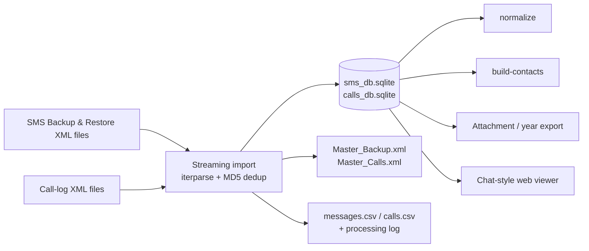
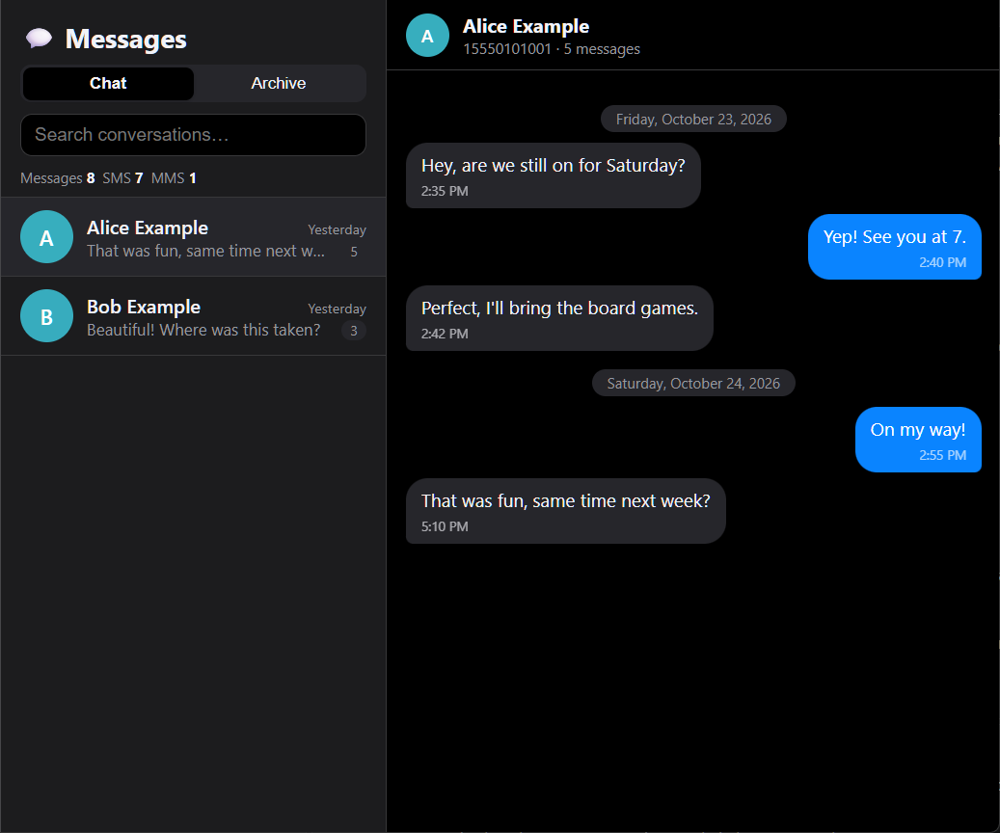
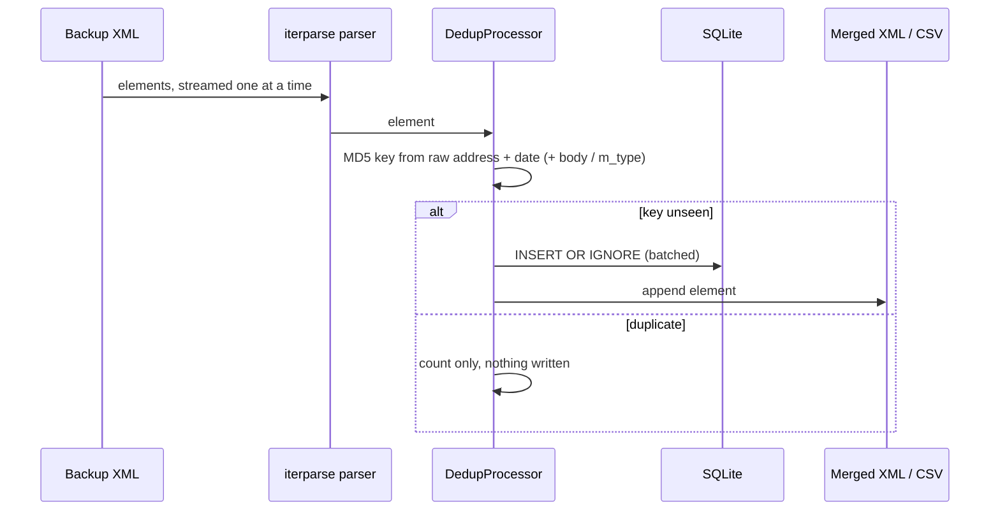
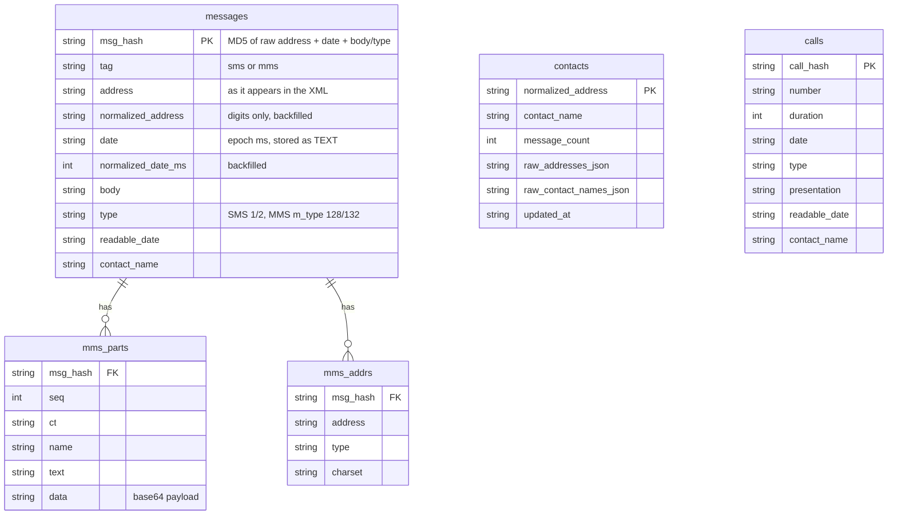

# sms-toolkit

[](https://github.com/enonymous1/sms-toolkit/actions/workflows/ci.yml)
[](https://www.python.org/downloads/)
[](LICENSE)

**Your backup app copies everything, every day. This keeps only what's new.**

## Description

sms-toolkit turns Android SMS/call history into a clean, browsable archive.

[SMS Backup & Restore](https://synctech.com.au/sms-backup-restore/) makes
**full** backups on every scheduled run by default, so years of accumulated
backups are dozens of multi-GB XML files that are ~99% duplicates of each
other. sms-toolkit streams those files, drops the duplicates by MD5 hash,
and keeps one SQLite database — importing only what's genuinely new, every
time.



A real import of 40 accumulated backup files shows the shape of the problem:

```text
Total items processed:         1,146,266
  - SMS: 349,012
  - MMS: 797,254
Unique items found:            2,499
Duplicates removed:            1,143,767
Deduplication Rate:            99.78%
```



## Features

- **Streaming de-dup import** — `sms` and `calls` import XML backups in
  append mode by default; already-imported messages are skipped via
  `INSERT OR IGNORE` on their MD5 hash. Re-importing the same folder twice
  adds nothing. A run that fails on any file exits 1 and lists the files
  that were not imported.
- **Normalization** — canonical phone/address and epoch-ms date backfill
  for rows imported before those columns existed (report-only by default;
  `--apply` rewrites rows, so pair it with `--backup`).
- **Contacts** — builds a `contacts` table mapping canonical addresses to
  contact names, including multi-participant MMS pairing (UPSERT, never a
  rebuild).
- **IFTTT import** — imports IFTTT-generated SMS from Excel with the same
  hash + same-day dedupe rules.
- **Attachment export** — MMS parts out to files with safe names, plus CSVs
  and a thread summary (MMS sent/received counted from `m_type` 128/132).
- **Year export** — carves one calendar year into a standalone SQLite DB.
  It refuses to write over the source database.
- **Screenshot OCR** — extracts conversations from message-app screenshots
  (four strategies, `v1`–`v4`, consolidated from four copy-pasted scripts)
  and fuzzy-matches them against the database.
- **Chat-style viewer** — a Flask app that looks like a messaging app:
  conversation list, sent/received bubbles, day dividers, inline MMS photos
  with lightbox, plus an archive list view with search and pagination.
- **Diagnostics** — `diag` checks DB existence, integrity, row counts, tag
  breakdown, date range, MMS inventory, and contacts; exit code 0/1.
- **Static demo** — `scripts/freeze.py` renders the viewer as a static
  site from fictional seed data (no real messages, ever) for GitHub Pages.

## Non-goals

- **Not a backup app.** It reads the XML files another app makes; it never
  touches your phone.
- **Not a restore tool.** It cannot put messages back on a phone — use
  SMS Backup & Restore itself for that.
- **Not a cloud service.** Nothing is uploaded anywhere; the database
  lives wherever you put it.
- **Not destructive.** Imports append by default and skip what is already
  there. The only way to wipe is an explicit `--fresh`, and the original
  XML files are never modified.

## Prerequisites

- **Python 3.10, 3.11, or 3.12.** CI runs the full gate matrix on all
  three on Ubuntu, plus a Windows leg on 3.12.
- **git**, for the source install below.
- **Tesseract** (system binary on `PATH`) — only needed for the
  `pytesseract` OCR path.
- **~2 GB of downloads on first EasyOCR use** — torch plus the detection
  and recognition models. The `ocr` extra uses headless OpenCV
  (`opencv-python-headless`); no GUI libraries are required.
- **Disk and memory sized to the archive.** The dedup hash set lives in
  memory and grows with unique messages, and the database itself is roughly
  the size of the unique content (the reference import above produced a
  ~8 GB database from 260 GB of backups).

## Installation

```bash
python -m venv .venv
source .venv/bin/activate        # Windows: .venv\Scripts\activate
pip install -e ".[excel,viewer,ocr]"
```

Extras are optional and independent:

| Extra    | Provides                                                                 |
|----------|--------------------------------------------------------------------------|
| `excel`  | IFTTT Excel import (`pandas`, `openpyxl`)                                |
| `viewer` | the Flask web viewer (`flask`)                                           |
| `ocr`    | screenshot OCR (`pillow`, `numpy`, `pytesseract`, `easyocr`, `opencv-python-headless`, `thefuzz`) |
| `dev`    | `pytest`, `ruff`, `mypy` and type stubs                                  |

A base install (no extras) covers import, normalize, contacts, exports,
and diagnostics — it only needs `lxml` and `tqdm`.

## Quick start

```bash
# 1. Import new backups (append mode: only new messages land)
sms-toolkit --root ./data sms ./backups/xml

# 2. Check the database
sms-toolkit diag --db ./data/sms_db.sqlite

# 3. Backfill normalized columns, then rebuild contacts (dry-run first)
sms-toolkit --root ./data normalize --report
sms-toolkit --root ./data normalize --apply --backup
sms-toolkit --root ./data build-contacts --dry-run
sms-toolkit --root ./data build-contacts

# 4. Browse it
sms-toolkit serve --db ./data/sms_db.sqlite
# → http://127.0.0.1:5000
```

`--root` is the directory holding the outputs (or set `SMS_TOOLKIT_ROOT`
once and omit it). Every command that takes `--db` also accepts it directly.
An import lands four artifacts in `--root` alongside each other: the SQLite
database (`sms_db.sqlite` / `calls_db.sqlite`), the merged XML
(`Master_Backup.xml` / `Master_Calls.xml`), the CSV (`messages.csv` /
`calls.csv`), and the processing log (`processing_log.txt` /
`calls_processing_log.txt`).

## Commands

| Command              | What it does |
|----------------------|--------------|
| `sms <input-dir>`    | Import SMS/MMS XML backups into the DB |
| `calls <input-dir>`  | Import call-log XML backups |
| `normalize`          | Report (`--report`) or apply (`--apply`, with `--backup`) the address/date backfill. Bare `normalize` errors — pick a mode. |
| `build-contacts`     | Build/refresh the contacts table (`--dry-run` to preview) |
| `import-ifttt`       | Import IFTTT SMS from Excel workbooks (dry-run by default; `--execute` writes) |
| `export-attachments` | Export MMS attachments + CSVs + thread summary. `--db` is **required**. |
| `export-year`        | Export one year to a separate SQLite DB |
| `ocr-extract`        | Extract messages from screenshots (`--strategy v1\|v2\|v3\|v4`) |
| `ocr-match`          | Fuzzy-match extracted messages against the DB |
| `serve`              | Run the web viewer (`--db/--host/--port/--debug/--per-page`) |
| `diag`               | Database + environment health check (exit 0/1) |

Run `sms-toolkit <command> --help` for each command's flags.

## The viewer

`serve` starts a two-pane app: a conversation list on the left (avatar,
snippet, timestamp, message count, search) and a thread view on the right
with iMessage-style bubbles — blue on the right for sent, grey on the left
for received, derived from the backup's `type` field (SMS 1/2, MMS
`m_type` 128/132). MMS photos render inline (click to enlarge); clicking
any bubble shows the full message detail (parts, addresses). A **Chat /
Archive** toggle switches to the classic searchable, paginated list. Dark
mode follows the OS; on narrow screens the list collapses to a back-button
flow.

The viewer opens the database **read-only** (`mode=ro`), so it can neither
create nor modify it: a missing database answers 503 instead of silently
creating an empty one (the original script's behavior was to create an
empty DB and then 500 on every page). There is no authentication — never
expose it beyond localhost. `--debug` with a non-loopback `--host` is
refused outright.

## How it works



The pipeline is generic: a *variant* supplies the element tag, the key
function, the row mapping, and the DDL, and the same streaming core serves
both `sms` and `calls`. Imports append by default — the hash set is loaded
from the existing database, so already-imported messages are skipped.
`--fresh` archives the previous outputs (timestamped, including SQLite
`-wal`/`-shm`/`-journal` sidecars) and starts empty; an archive failure
aborts before anything is truncated. SQLite runs with crash-safe defaults
(`journal_mode=WAL`, `synchronous=NORMAL`, 64 MiB page cache).

## Data model



`contacts` is built from `messages` by `build-contacts` (UPSERT, never a
rebuild) and is not a declared foreign key — it is a derived lookup table.
`export-year` output is lossy by design: it carries the message subset for
one year, not the normalized columns or the contacts table.

## Configuration

`load_config()` builds an `AppConfig` from defaults plus environment
overrides:

| Variable                 | Default              |
|--------------------------|----------------------|
| `SMS_TOOLKIT_ROOT`       | current directory    |
| `SMS_TOOLKIT_LOG_LEVEL`  | `INFO`               |
| `SMS_TOOLKIT_LOG_FILE`   | (console only)       |
| `SMS_TOOLKIT_SMS_DB`     | `sms_db.sqlite`      |
| `SMS_TOOLKIT_CALLS_DB`   | `calls_db.sqlite`    |
| `SMS_TOOLKIT_BATCH_SIZE` | `5000`               |
| `SMS_TOOLKIT_RETRIES`    | `3`                  |

Malformed integer values warn and fall back to the default rather than
crashing.

## Local Development

```bash
python -m venv .venv
source .venv/bin/activate
pip install -e ".[dev,excel,viewer]"

ruff check src tests scripts
ruff format --check src tests scripts
mypy --strict src
pytest
```

`python scripts/freeze.py` rebuilds the static demo into `freeze-site/`
(gitignored; wiped and rebuilt on every run) from fictional seed data.

The `.[dev]`-only install is not enough: the suite's Excel and viewer
tests need those extras to even collect. All four gates are green at the
current commit. The suite includes differential tests that run the
refactored code against the `original/` sources on identical inputs —
`tests/diff_helpers.py` AST-loads the originals, which is why `original/`
is load-bearing and must not be deleted.

## Deployment

The tool itself has no deployment: it is a local CLI, installed from the
GitHub source as above and run against your own backup folders. There is
no hosted service, no PyPI release, and no release workflow yet.

The one deployed surface is the **static viewer demo**: on every push to
`main` (and on manual dispatch), `.github/workflows/pages.yml` runs
`scripts/freeze.py` and publishes `freeze-site/` to GitHub Pages at
<https://enonymous1.github.io/sms-toolkit/>. One-time setup, on the
maintainer's side: Settings → Pages → Source: GitHub Actions. The demo
shows the viewer UI over invented Alice/Bob conversations only — it never
touches a real archive.

## Layout

```
src/sms_toolkit/
├── __init__.py        # version
├── cli.py             # sms-toolkit entry point
├── config.py          # Paths / PipelineConfig / ViewerConfig / LoggingConfig / AppConfig
├── logging_config.py  # setup_logging(), get_logger()
├── normalize.py       # canonical address/phone/date normalization
├── hashing.py         # byte-identical MD5 dedup keys
├── db.py              # SQLite connect/schema/backup/hash helpers
├── pipeline/          # generic streaming de-dup pipeline core
├── sms/               # SMS variant (tags, keying, DDL, SQL)
├── calls/             # calls variant
├── stages/            # one-shot DB stages (normalize, contacts, ifttt, exports)
├── ocr/               # screenshot OCR (strategies v1-v4, spatial, matcher)
├── viewer/            # Flask viewer (app factory, queries, templates)
│   └── templates/
│       └── index.html # two-pane chat UI
├── diag.py            # environment/database diagnostics (diag command)
└── tools/             # relocated dev utilities (export_to_md, byte-identical)
tests/                 # pytest suite (incl. differential tests vs original/)
├── diff_helpers.py    # AST-loads original/ modules for differential tests
└── stage_fixtures.py  # shared fixture DB builders
original/              # reconstruction of the pre-refactor sources (see original/README.md)
```

<details>
<summary>Provenance and behavior notes</summary>

Refactored from `ss-sms-br`, a set of one-off scripts grown around SMS
Backup & Restore exports. The refactor (7 phases, Oct 2026) unified them
into one installable package while preserving behavior, verified by
differential tests at each phase. The `original/` sources are pristine
reconstructions, kept frozen — they are the differential-test oracle, not
shipped in the wheel/sdist. Deliberate, documented deviations from the
originals:

- MD5 dedup hashes are byte-identical — they are primary keys in existing
  databases, so changing them would orphan history.
- Stage modules use plain `sqlite3.connect`, not the pipeline's connection
  helper, whose PRAGMAs are unsafe for one-shot writes to the primary DB.
- The viewer hardens the original's failure modes: unknown message hash →
  404 (was 500), non-integer `page` → 400 (was 500), corrupt base64 image →
  404 (was 500).
- `date` may be stored as TEXT in real databases; date handling coerces
  defensively throughout.
- The original viewer template was missing from the export, so the shipped
  template is new; the original script itself is preserved under
  `original/` for reference.
- One-off exploratory scripts (`extract_sample.py`, `extract_extremes.py`,
  `scripts/maintenance/*_analysis*.py`) stay as originals only — superseded
  by `export-attachments` and `diag`.
- `tools/export_to_md.py` is the original `utils/export_to_markdown.py`
  relocated byte-identical (frozen: excluded from ruff, mypy override),
  because it has a latent str/list type inconsistency in one branch.

</details>

## License

MIT — see [LICENSE](LICENSE).
